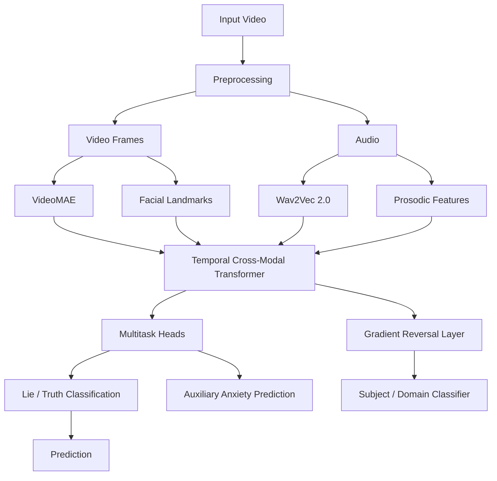

# AI-Powered Multimodal Lie Detection System

> A research-oriented multimodal deception detection system that analyzes **facial behavior and vocal characteristics** from video using temporal transformers, multimodal fusion, multi-task learning, adversarial domain adaptation, and strict Leave-One-Subject-Out (LOSO) evaluation.

---

## 📌 Overview

Detecting deception from human behavior is a challenging problem because deceptive behavior can manifest through multiple weak and noisy signals.

This project develops an **AI-powered multimodal lie detection system** that takes a video containing a speaker's statement and analyzes complementary visual and acoustic information to classify the statement as:

- **Truth**
- **Lie**

Instead of relying on a single behavioral signal, the system combines:

- 🎥 **Visual features** extracted using VideoMAE
- 🙂 **Facial landmark dynamics** extracted from video frames
- 🎙️ **Speech representations** extracted using Wav2Vec 2.0
- 🔊 **Prosodic features** describing vocal behavior
- 🧠 **Temporal cross-modal transformer** for multimodal fusion
- 🎯 **Multi-task learning** with an auxiliary anxiety prediction task
- 🔄 **Gradient Reversal Layer (GRL)** for adversarial subject/domain adaptation
- 📊 **Strict Leave-One-Subject-Out (LOSO)** evaluation to reduce subject leakage

The project is designed as a **research prototype**, not as a forensic or legal lie-detection system.

---

## 🏗️ System Architecture



---

## 🔬 Multimodal Representation

The system preserves temporal information instead of immediately collapsing each modality into a single vector.

| Modality | Representation | Encoder / Method |
|---|---|---|
| Visual | `(8, 768)` temporal sequence | VideoMAE |
| Facial | `(16, 1404)` temporal sequence | Facial landmarks |
| Speech | `(16, 768)` temporal sequence | Wav2Vec 2.0 |
| Prosody | `(16, 7)` contour | Prosodic feature extraction |

These representations are converted into modality-aware tokens and passed into a shared temporal cross-modal transformer.

### Why preserve temporal sequences?

Deception-related behavioral cues may occur as **changes over time**, rather than as static characteristics.

Therefore, the architecture avoids unnecessary early pooling and allows the transformer to model relationships:

- within individual modalities
- between visual and audio modalities
- across different temporal positions

---

## 🧠 Model Components

### 1. VideoMAE Visual Encoder

VideoMAE is used as a pretrained spatio-temporal visual encoder.

The extracted representation is retained as an **8-step temporal sequence** rather than being immediately pooled.

### 2. Facial Landmark Stream

Facial landmarks provide geometric information about facial movement.

The system preserves a raw:

```text
16 × 1404
```

temporal sequence.

The facial landmark stream is passed independently into the multimodal fusion stage.

### 3. Wav2Vec 2.0 Audio Encoder

Wav2Vec 2.0 provides contextual speech representations.

The audio representation is retained as a:

```text
16 × 768
```

temporal sequence.

### 4. Prosodic Features

The system extracts a seven-dimensional prosodic representation over 16 temporal segments:

```text
16 × 7
```

This provides information about vocal behavior such as changes in speech characteristics over time.

### 5. Temporal Cross-Modal Transformer

The four streams are converted into tokens and combined with:

- temporal positional information
- modality embeddings
- a classification token

Self-attention allows information to flow across modalities and temporal positions.

### 6. Multi-Task Learning

The fused representation is used by multiple task heads.

**Primary task:**

```text
Lie / Truth Classification
```

**Auxiliary task:**

```text
Anxiety Prediction
```

The auxiliary task is intended to act as a regularizer and encourage the representation to capture behavioral information beyond the primary classification label.

### 7. Adversarial Domain Adaptation

A **Gradient Reversal Layer (GRL)** is used with a subject/domain classifier.

The objective is to discourage the learned representation from becoming overly dependent on the identity of a particular participant.

Conceptually:

```text
Fused Representation
        │
        ├──────────────► Lie Classifier
        │
        ├──────────────► Anxiety Head
        │
        └──► GRL ──────► Subject Classifier
```

This is particularly important for deception datasets where individual behavioral characteristics can otherwise become shortcuts for classification.

---

# 📊 Evaluation Strategy

## Leave-One-Subject-Out Evaluation

The project uses **strict LOSO evaluation**.

For each fold:

```text
One subject → held out for testing
All remaining subjects → training
```

This prevents samples from the same person appearing in both training and test partitions.

The process is repeated across the available subjects and predictions are aggregated for overall evaluation.

### Metrics

The evaluation pipeline supports:

- Accuracy
- Precision
- Recall
- F1-score
- ROC-AUC
- Equal Error Rate (EER)
- Expected Calibration Error (ECE)

---

# 🧪 Calibration

The repository includes calibration components for improving the interpretation of predicted probabilities.

Implemented methods include:

- Temperature scaling
- Monte-Carlo dropout infrastructure

Temperature scaling is implemented with safeguards for unstable temperature estimates.

> **Important:** A prediction probability should not automatically be interpreted as a real-world probability that a person is lying. This system is a research prototype and should not be used for high-stakes decisions.

---

# 📁 Project Structure

```text
AI_powered_lieDetectionSystem/
│
├── calibration/
│   ├── mc_dropout.py
│   └── temperature_scaling.py
│
├── configs/
│   ├── default.yaml
│   ├── model.yaml
│   ├── preprocess.yaml
│   └── train.yaml
│
├── data/
│   └── raw/
│
├── domain_adaptation/
│   ├── domain_classifier.py
│   └── grl.py
│
├── evaluation/
│   ├── loso_evaluator.py
│   └── metrics.py
│
├── fusion/
│   └── temporal_cross_modal.py
│
├── inference/
│   └── file_predictor.py
│
├── models/
│   ├── deception_model.py
│   ├── landmark_extractor.py
│   ├── prosodic_features.py
│   ├── videomae_encoder.py
│   └── wav2vec_encoder.py
│
├── multitask/
│   ├── heads.py
│   └── multitask_loss.py
│
├── preprocessing/
│   ├── audio_extractor.py
│   ├── run_preprocessing.py
│   └── video_normalizer.py
│
├── scripts/
│   ├── 01_build_metadata.py
│   ├── 02_preprocess.py
│   ├── 03_extract_audio.py
│   ├── 03_extract_embeddings.py
│   ├── 04_run_loso.py
│   ├── create_inference_bundle.py
│   └── demo_predict.py
│
├── trainers/
│   ├── base_trainer.py
│   └── multitask_trainer.py
│
├── utils/
│   ├── config.py
│   ├── device.py
│   ├── logging_utils.py
│   ├── seed.py
│   └── video_frames.py
│
├── compare_da.py
├── linear_probe.py
├── overfit_test.py
├── plot_results.py
├── show_results.py
├── sweep_lambda.py
├── train.py
│
├── environment.yml
├── requirements.txt
├── setup_runpod.sh
├── setup_windows.bat
├── .gitignore
└── README.md
```

---

# ⚙️ Installation

## Requirements

Recommended environment:

- Python 3.10
- PyTorch
- Transformers
- NumPy
- OpenCV
- Librosa
- MediaPipe
- FFmpeg

The complete Python dependencies are listed in:

```text
requirements.txt
```

A Conda environment specification is also provided:

```text
environment.yml
```

### Create the environment

```bash
conda create -n liedetect python=3.10
conda activate liedetect
```

Install dependencies:

```bash
pip install -r requirements.txt
```

FFmpeg should also be available on the system `PATH`.

---

# 🗂️ Dataset

This project uses the **MU3D (Miami University Deception Detection Database)**.

The dataset itself is **not included in this repository**.

You must obtain the dataset through the appropriate source/licensing process before running the complete preprocessing and training pipeline.

The expected local data layout should follow the structure used by the preprocessing scripts.

```text
data/
└── raw/
    └── <dataset videos>
```

Generated intermediate data, embeddings, model checkpoints, and other large artifacts are intentionally excluded from GitHub through `.gitignore`.

---

# 🚀 Running the Pipeline

## 1. Build Metadata

```bash
python scripts/01_build_metadata.py
```

## 2. Preprocess Videos

```bash
python scripts/02_preprocess.py
```

## 3. Extract Embeddings

```bash
python scripts/03_extract_embeddings.py
```

## 4. Extract Audio Features

```bash
python scripts/03_extract_audio.py
```

## 5. Run Training

```bash
python train.py
```

## 6. Run a Small Sanity Test

Before a full experiment, use:

```bash
python overfit_test.py
```

This can help identify implementation or data-pipeline problems before committing computational resources to a full experiment.

## 7. Run LOSO Evaluation

For an initial smoke test:

```bash
python scripts/04_run_loso.py --folds 5
```

For the complete evaluation:

```bash
python scripts/04_run_loso.py
```

> Full LOSO evaluation can be computationally expensive depending on the hardware and configuration.

---

# 🔎 Inference

The project also contains a prediction pipeline for running inference on an individual video.

First create the inference bundle:

```bash
python scripts/create_inference_bundle.py
```

Then run the prediction application using the project's inference script/environment.

The inference pipeline reuses the trained model and feature-extraction process rather than retraining the model.

---

# 🧩 Important Design Principles

### No subject leakage

The evaluation protocol is designed around subject-independent testing.

### Multimodal learning

Visual and acoustic signals are processed independently before being jointly modeled.

### Temporal modeling

Temporal sequences are retained to allow the fusion transformer to model behavioral changes over time.

### Adversarial subject invariance

The GRL-based domain adaptation component attempts to reduce dependence on participant identity.

### Reproducibility

Configuration files, environment specifications, preprocessing scripts, training scripts, and evaluation code are included in the repository.

---

# 📌 Limitations

This project should be interpreted as an **experimental machine-learning research system**, not as a reliable method for determining whether a person is actually lying.

Important limitations include:

- Human deception is highly context dependent.
- Behavioral cues are not uniquely associated with deception.
- Dataset size and diversity limit generalization.
- Dataset-specific biases may remain.
- Performance on controlled datasets does not guarantee performance in real-world environments.
- Model confidence should not be treated as proof of deception.
- External datasets and real-world testing are required before making broader claims.

---

# 🔮 Future Work

Potential extensions include:

- LoRA-based fine-tuning of pretrained visual and audio backbones
- More advanced audio representations
- eGeMAPS / richer acoustic features
- Facial Action Units
- Improved cross-modal attention mechanisms
- Larger and more diverse deception datasets
- Cross-dataset evaluation
- More robust probability calibration
- GPU-accelerated training
- Real-time video inference
- Improved interpretability and error analysis
- Evaluation under uncontrolled real-world conditions

---

# 🛠️ Technologies Used

| Category | Technologies |
|---|---|
| Language | Python |
| Deep Learning | PyTorch |
| Transformers | Hugging Face Transformers |
| Visual Encoder | VideoMAE |
| Audio Encoder | Wav2Vec 2.0 |
| Facial Analysis | MediaPipe |
| Audio Processing | Librosa |
| Video Processing | OpenCV, FFmpeg |
| Fusion | Temporal Cross-Modal Transformer |
| Domain Adaptation | Gradient Reversal Layer |
| Evaluation | LOSO, ROC-AUC, F1, EER, ECE |
| Environment | Conda / pip |

---

# 📚 Research Context

This project builds upon research in:

- Audio-visual deception detection
- Multimodal representation learning
- Temporal transformers
- Parameter-efficient fine-tuning
- Domain-adversarial learning
- Subject-independent evaluation
- Behavioral signal processing

Relevant datasets and research areas include MU3D and other publicly studied deception-detection benchmarks.

---

# 👨‍💻 Project

**AI-Powered Multimodal Lie Detection System**

Developed as an academic/research project exploring multimodal machine learning for deception detection.

**Repository:**  
`debarghya2002/AI_powered_lieDetectionSystem`

---

## ⚠️ Disclaimer

This software is intended **for academic and research purposes only**.

It should not be used to make decisions about a person's honesty, criminal responsibility, employment, medical treatment, financial eligibility, or any other high-stakes decision.

A model prediction is not evidence that a person is lying.
